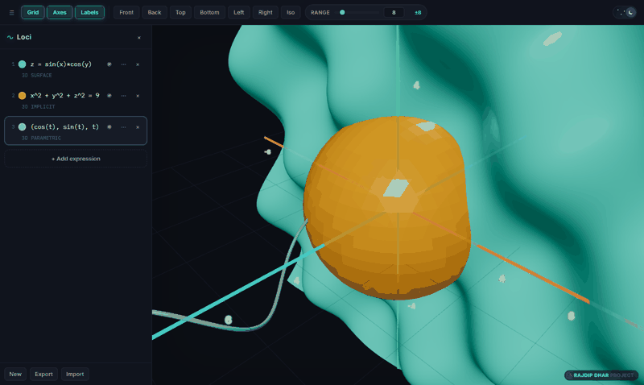
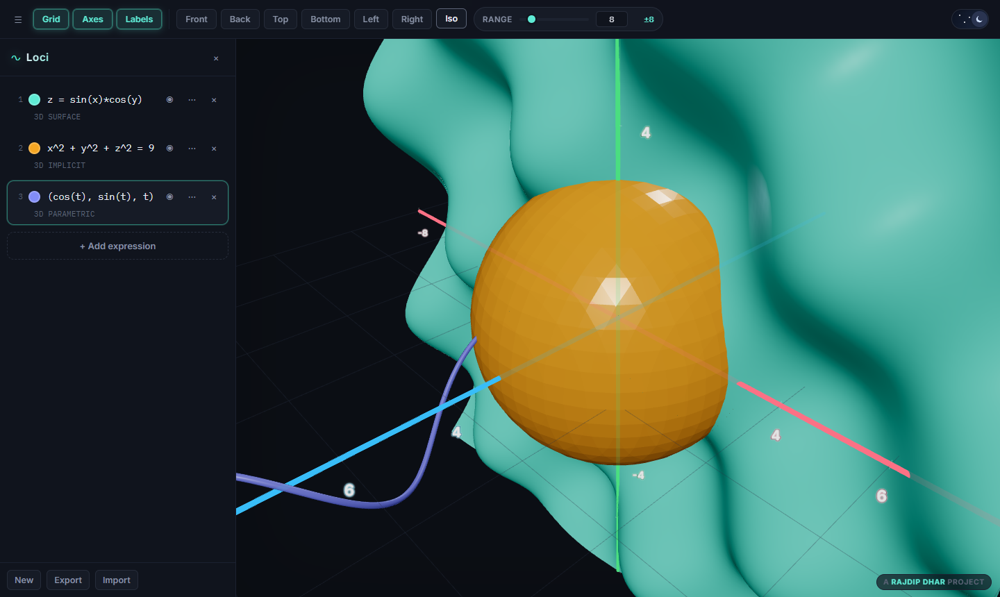
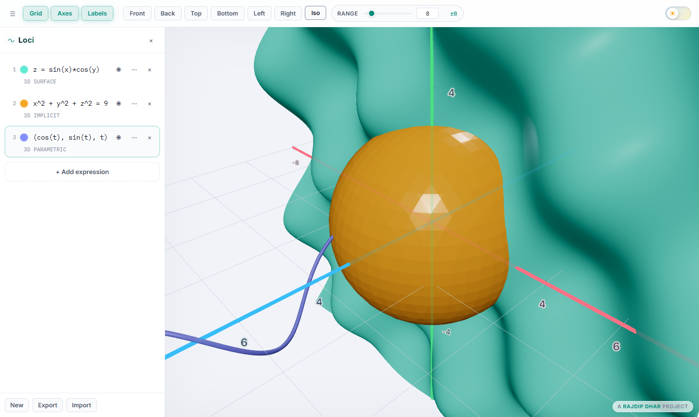
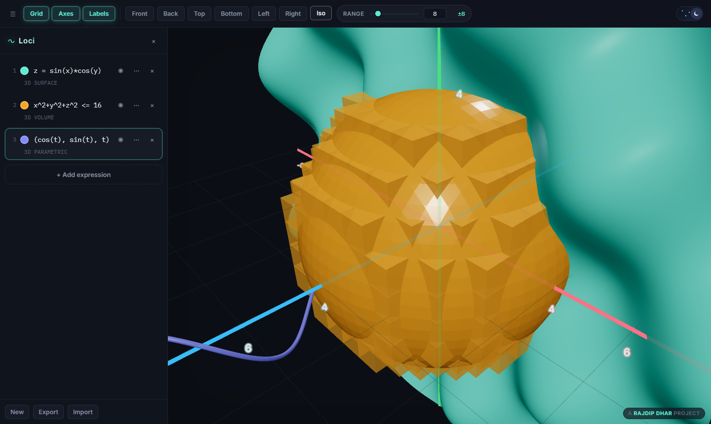
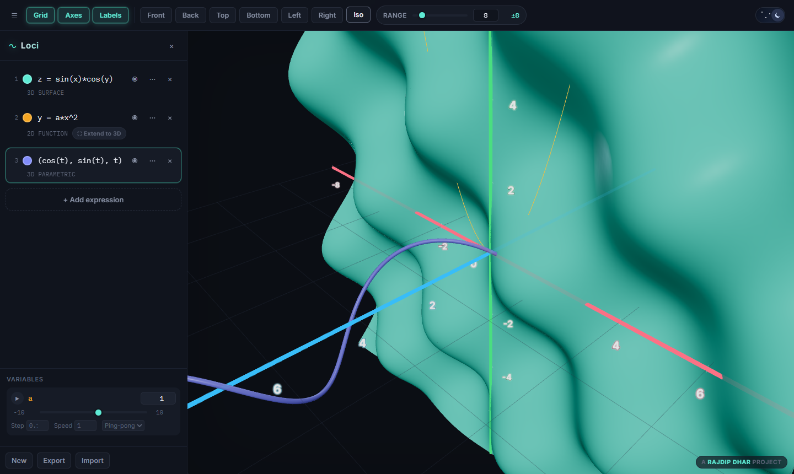

<div align="center">



<a href="https://github.com/RajdipDhar2007/Loci">
  
</a>

<br/>


<br/>



<sub>↑ Real capture of the running app — drag, flick, and it keeps spinning.</sub>

</div>

<br/>

## ✨ What is Loci?

A browser-based graphing calculator that renders **everything** — 2D functions, implicit curves, inequalities, parametric curves, and full 3D surfaces — in **one live, interactive 3D scene**.

There is no 2D/3D mode switch. A 2D equation is simply auto-embedded on whichever principal plane (**XY / XZ / YZ**) it belongs to, right next to your 3D graphs. Type, and it draws. No Enter key. No setup.

<br/>



## 📸 See it in action

<div align="center">

### 🌙 Dark — surfaces, implicit shapes & parametric curves together


### ☀️ Light — same scene, same speed


### 🧊 True 3D inequality volumes — not just a boundary shell


### 🎚️ Any unknown symbol becomes a slider — instantly


</div>

<br/>

## 🚀 Run it

```bash
npm install
npm run dev       # http://localhost:5173
npm run build     # type-check + production build -> dist/
npm run preview   # serve the production build
npm test          # vitest unit tests (parser + geometry)
npm run lint      # oxlint
```

<br/>

## 🧠 What it understands

Type any of these directly — the graph updates live as you type (debounced ~180ms), no Enter required:

| Expression | What you get |
|---|---|
| `y = x^2`, `x = y^2` | Explicit 2D function, embedded on the XY plane |
| `z = sin(x)`, `y = sin(z)`, `x = z^2` | Explicit 2D function on the XZ or YZ plane |
| `x^2 + y^2 = 25` | Implicit 2D curve |
| `x^2 + z^2 = 25`, `y^2 + z^2 = 25` | Implicit 2D curve, auto-embedded on XZ / YZ |
| `x < y^2`, `x^2 + y^2 <= 25` | Shaded 2D inequality region |
| `z = sin(x)*cos(y)` | Explicit 3D surface |
| `x^2 + y^2 + z^2 = 25` | Implicit 3D surface (marching tetrahedra) |
| `x > y + z`, `x^2+y^2+z^2 <= 25` | True 3D inequality **volume fill** — `<`, `<=`, `>`, `>=`, and `=` all look visibly different |
| `(cos(t), sin(t))` / `(cos(t), sin(t), t)` | 2D / 3D parametric curve |
| `a = 5` | Defines a variable and auto-creates a slider |
| `y = a*x^2` | Any symbol other than x/y/z becomes a slider automatically |

Any 2D curve or region can also be **extended into 3D** with one click — its missing axis is swept out so `x + y = 9` becomes a full plane instead of a line.

All standard functions (`sin cos tan cot sec csc` + inverses/hyperbolics, `log ln log10 sqrt cbrt abs floor ceil round exp sign min max`), `pi`, `e`, implicit multiplication, and nested parentheses are supported. Invalid expressions never crash the app — they show an inline error tag.

<br/>

## 🎮 Interacting with the scene

| | |
|---|---|
| 🌀 **Rotate** | Click/touch and drag. Flick it and it keeps spinning until you grab it again. |
| 🔍 **Zoom / Pan** | Scroll or pinch · right-click drag (or two-finger drag) |
| 🎥 **Camera presets** | Front / Back / Top / Bottom / Left / Right / Iso |
| 📏 **Range slider** | One master control scales all three axes, from ±2 to effectively unbounded |
| 🧭 **Grid / Axes / Labels** | Independent toggles; thick, arrow-tipped, constant-thickness axes with glowing labels that hide behind surfaces |
| 🎨 **Per-expression styling** | Color, opacity, solid/dashed/dotted, render quality, extrude-to-3D |

**Shortcuts:** `N` add expression · `G` toggle grid · `R` reset camera

<br/>

## 🏗️ Architecture

```
src/math/       expression parsing, graph-type detection, marching squares
                (2D contours) and marching tetrahedra (3D isosurfaces)
src/store/      zustand store — expressions, variables, camera, theme,
                view/range settings, localStorage persistence, JSON import/export
src/render/     Scene3D — the single Three.js scene rendering every graph type
src/components/ toolbar, sidebar, expression rows, variable sliders, theme toggle
```

<details>
<summary><b>🔬 Under the hood (click to expand)</b></summary>

<br/>

- Parsing/eval uses `mathjs` compiled expressions — never `eval`.
- 3D implicit surfaces use marching tetrahedra (6 tets per cube); 3D inequalities render as an instanced-voxel volume fill (plus an optional boundary shell) so the satisfied region is genuinely visible.
- Surfaces use a physically-based material (opaque by default, clearcoat, ACES tone mapping) so intersections are readable.
- Geometry rebuilds are **throttled**, not debounced, so slider animation and live typing both stay smooth. Quality auto-degrades while a variable animates, then restores.
- Sliders animate via `requestAnimationFrame`, ping-pong or loop, with per-variable range/step/speed.
- Workspace auto-saves to `localStorage` and can be exported/imported as JSON.

</details>

<details>
<summary><b>⚠️ Known limitations</b></summary>

<br/>

- Parametric *surfaces* (two parameters, e.g. `u, v`) aren't supported — only single-parameter parametric curves.
- Extremely large range values trade some sampling density for performance, since mesh resolution is capped.

</details>

<br/>

## 🤝 Contributing

Issues, ideas, and pull requests are welcome.

1. Fork the repository
2. Create a feature branch (`git checkout -b feature/your-feature`)
3. Commit your changes (`git commit -m 'Add some feature'`)
4. Push and open a pull request

Please run `npm run lint` and `npm run build` before submitting.

## 📜 License

Distributed under the MIT License — see [`LICENSE`](./LICENSE).

<br/>

<div align="center">

## 💚 If Loci made your math prettier, a ⭐ on the repo would make my day.

<br/>

<a href="https://github.com/RajdipDhar2007/Loci"></a>
<a href="https://github.com/RajdipDhar2007"></a>

</div>



<div align="center">


</div>
